# Sermo 1.37.0 (build 69) Implementation Plan

> **For agentic workers:** REQUIRED SUB-SKILL: Use superpowers:subagent-driven-development (recommended) or superpowers:executing-plans to implement this plan task-by-task. Steps use checkbox (`- [ ]`) syntax for tracking.

**Goal:** Deliver `Sermo 1.37.0 (build 69)` with cross-window today/weak vocabulary sync, casual out-of-pack word auto-saving, universal time awareness and default-enabled GitHub/Drive/Web tools across ChatGPT Subscription and DeepSeek (inside and outside projects), direct URL/GitHub repo reading on web search, CJK `**...**` punctuation Markdown fix, fuller CC default font weight, and project-page today's word pills.

**Architecture:** Extend `StudyMemoryStore.gradeWordsFree` to emit `StudyWordEvent` rows for weekly/voice review compatibility and return out-of-pack words to auto-save in `StudyToolExecutor`; enrich `StudyToolExecutor.context(query:)` with today's and weak words across threads; unlock `ProjectToolAccess` and `AppStore` tool/time wiring for `.chatGPT` and non-project chats with credential-aware defaults; add direct URL & GitHub repo reading to `WebPageReader` / `AppStore`; and add a CJK `**` flanking normalizer in `HighlightMarker.swift` plus default-on `Personal.mediumBody` (`stored(mediumKey) != "0"`) and `.bold` emphasis in `AppTheme.swift` / `ContentView.swift`.

**Architecture Diagram:**

```mermaid
graph TD
    subgraph "Universal Chat & Tool Loop (AppStore + ToolCalling)"
        Time["Default Time & Elapsed Awareness (Project + Non-Project)"]
        Tools["Default-On GitHub / Drive / Web Tools (ChatGPT + DeepSeek)"]
        Web["Direct URL & GitHub Repo Reader + Context WebSearch"]
    end
    subgraph "Cross-Window Study Engine (StudyVocabulary + StudyToolExecutor)"
        Ctx["Cross-Window Today & Weak Words in [学习账本概况]"]
        Grade["gradeWordsFree -> FSRS v6 + StudyWordEvent + Out-of-Pack 生词本 Fallback"]
        Review["StudyReview (Voice Prompt & Weekly Report)"]
    end
    subgraph "CC Warm UI & CJK Markdown (HighlightMarker + AppTheme + ProjectsView)"
        CJK["CJK Punctuation **Bold** Normalizer (Zero Raw Asterisks)"]
        Font["Default Medium Body + Bold Terracotta Emphasis"]
        Pills["Project Page & StudyMemoryView Today's Word Pills"]
    end
    Time --> Tools
    Tools --> Web
    Ctx --> Grade
    Grade --> Review
    CJK --> Font
    Font --> Pills
```

**Tech Stack:** Swift 5.9, SwiftUI (iOS 17+), SQLite3, `swift-fsrs` (FSRS v6), XCTest (`swift test` on macOS + `xcodebuild` for iOS `arm64`).

**Spec:** [2026-11-12-build69-seamless-tools-cjk-ui-design.md](file:///C:/Users/Administrator/.gemini/antigravity/scratch/qingjian-ios/docs/superpowers/specs/2026-11-12-build69-seamless-tools-cjk-ui-design.md)

## Global Constraints

- Bundle ID MUST remain `com.xiaolong.qingjian`; marketing version `1.37.0`, build version `69` (`CFBundleVersion = 69`).
- Stay on git branch `cleanup-1.37`; never modify `.github/workflows/*.yml` or `main`.
- Existing SQLite `study_data` rows and `StudyBackupCodec` / `StudyRestoreEngine` archives MUST remain 100% backward-compatible.
- Explicit tool opt-out on a project (`project.githubTools == false`, `project.driveTools == false`, `project.webTools == false`) MUST still revoke access to that tool family (`IntegrationSafetyTests`).

## Review Focus

- **CJK fullwidth punctuation inside `**...**`:** Input like `**1914年9月，第一次马恩河战役。**英法联军` or `在**“坦嫩堡战役”**中` must parse into `.stronglyEmphasized` without leaving literal `**` characters, while never corrupting inline code spans (`` `**not bold**` ``) or triple-backtick code blocks.
- **Cross-window word visibility & voice/weekly review sync:** Grading `"adapt"` in Window 1 and `"adopt"` in Window 2 via `study_grade_word` must both appear in Window 3's `StudyToolExecutor.context(query:)` under `今日已聊单词` AND appear in `store.voiceReview(...)` / `store.weeklyReport(...)`.
- **Out-of-pack casual word grading:** Calling `study_grade_word(word: "conspicuous", rating: "hard")` when `"conspicuous"` is not in `word_pack` must not throw an error; it must save `"conspicuous"` into the project's `"生词"` memory category and return a clear confirmation.
- **ChatGPT Subscription & non-project tool access:** `ProjectToolAccess` must allow `github_*`, `drive_*`, and `web_*` for `.chatGPT` as well as `.deepSeek` when enabled (including default-on when not explicitly set to `false`), while still throwing `ToolError.disabledTool` when a project explicitly sets `githubTools = false` / `driveTools = false` / `webTools = false`.
- **Direct URL / GitHub link reading:** Passing a URL like `https://github.com/owner/repo` to `WebPageReader` or bottom-bar web search must read the target URL/repo directly rather than only running a blind 5-link keyword search.

---

### Task 1: Cross-Window Word Sync, `StudyWordEvent` Recording & Out-of-Pack Casual Word Fallback

**Files:**
- Modify: [StudyVocabulary.swift](file:///C:/Users/Administrator/.gemini/antigravity/scratch/qingjian-ios/QingJian/DeepSeekPocket/Core/StudyVocabulary.swift)
- Modify: [StudyToolExecutor.swift](file:///C:/Users/Administrator/.gemini/antigravity/scratch/qingjian-ios/QingJian/DeepSeekPocket/Core/StudyToolExecutor.swift)
- Modify: [StudyWordTools.swift](file:///C:/Users/Administrator/.gemini/antigravity/scratch/qingjian-ios/QingJian/DeepSeekPocket/Core/StudyWordTools.swift)
- Modify: [OperationManual.swift](file:///C:/Users/Administrator/.gemini/antigravity/scratch/qingjian-ios/QingJian/DeepSeekPocket/Core/OperationManual.swift)
- Modify: [StudyWordTests.swift](file:///C:/Users/Administrator/.gemini/antigravity/scratch/qingjian-ios/QingJian/Tests/StudyWordTests.swift), [StudyToolExecutorTests.swift](file:///C:/Users/Administrator/.gemini/antigravity/scratch/qingjian-ios/QingJian/Tests/StudyToolExecutorTests.swift), [OperationManualTests.swift](file:///C:/Users/Administrator/.gemini/antigravity/scratch/qingjian-ios/QingJian/Tests/OperationManualTests.swift)

- [ ] **Step 1: Add unit tests in `StudyWordTests.swift` and `StudyToolExecutorTests.swift` for cross-window today-word context, `StudyWordEvent` generation for `voiceReview`/`weeklyReport`, and out-of-pack casual word auto-saving to `生词` memory**
- [ ] **Step 2: Update `gradeWordsFree` in `StudyVocabulary.swift` to write `StudyWordEvent` rows (and mark `undone = true` on `undo`), and add `todayWordsList` / `weakWordsList` to `StudyWordPracticeSummary`**
- [ ] **Step 3: Update `StudyToolExecutor.swift` to include cross-window `今日已聊单词` & `近期薄弱词` in `[学习账本概况]`, and auto-save out-of-pack words in `performWordAction` into `"生词"` memory**
- [ ] **Step 4: Update `StudyWordTools.note` and `OperationManual.swift` (`version: 4`) to guide casual word auto-recording across windows, and update `OperationManualTests.swift`**

---

### Task 2: Universal Time Awareness, Default-On Tool Loop (ChatGPT + DeepSeek, Project + Non-Project) & Smart URL/GitHub Reader

**Files:**
- Modify: [Projects.swift](file:///C:/Users/Administrator/.gemini/antigravity/scratch/qingjian-ios/QingJian/DeepSeekPocket/Core/Projects.swift)
- Modify: [ToolCalling.swift](file:///C:/Users/Administrator/.gemini/antigravity/scratch/qingjian-ios/QingJian/DeepSeekPocket/Core/ToolCalling.swift)
- Modify: [PromptVariables.swift](file:///C:/Users/Administrator/.gemini/antigravity/scratch/qingjian-ios/QingJian/DeepSeekPocket/Core/PromptVariables.swift)
- Modify: [WebSearch.swift](file:///C:/Users/Administrator/.gemini/antigravity/scratch/qingjian-ios/QingJian/DeepSeekPocket/Core/WebSearch.swift)
- Modify: [WebPages.swift](file:///C:/Users/Administrator/.gemini/antigravity/scratch/qingjian-ios/QingJian/DeepSeekPocket/Core/WebPages.swift)
- Modify: [AppStore.swift](file:///C:/Users/Administrator/.gemini/antigravity/scratch/qingjian-ios/QingJian/DeepSeekPocket/AppStore.swift)
- Modify: [ProjectsView.swift](file:///C:/Users/Administrator/.gemini/antigravity/scratch/qingjian-ios/QingJian/DeepSeekPocket/Views/ProjectsView.swift)
- Modify: [IntegrationSafetyTests.swift](file:///C:/Users/Administrator/.gemini/antigravity/scratch/qingjian-ios/QingJian/Tests/IntegrationSafetyTests.swift), [PromptAndGitHubTests.swift](file:///C:/Users/Administrator/.gemini/antigravity/scratch/qingjian-ios/QingJian/Tests/PromptAndGitHubTests.swift)

- [ ] **Step 1: Update `Projects.swift` and `ToolCalling.swift` (`ProjectToolAccess`) so `.chatGPT`, `.deepSeek`, and `.colab` (with tools) all support `drive_*`, `github_*`, and `web_*`, with credential-aware default-on support when `project` is `nil` or tool flags are `nil` (while respecting explicit `false` opt-out)**
- [ ] **Step 2: Update `PromptVariables.swift` and `AppStore.swift` so current date/weekday/time and elapsed-time awareness are active by default in both project and non-project chats (`chatProject?.timeAwareness != false`)**
- [ ] **Step 3: Enhance `WebPageReader` (`WebPages.swift`), `WebSearchProtocol` (`WebSearch.swift`), and `AppStore.swift` so URLs (including `https://github.com/owner/repo`) are read directly (fetching GitHub repo metadata + `README` when applicable), `web_read` works without requiring a DeepSeek API key, and `WebSearchProtocol` allows up to 8 sources and `max_uses: 2`**
- [ ] **Step 4: Update `IntegrationSafetyTests.swift` and `PromptAndGitHubTests.swift` to verify `.chatGPT` and non-project tool access, explicit `false` opt-out, and GitHub URL parsing**

---

### Task 3: CJK Punctuation `**Bold**` Fix, Fuller CC Default Font & Project Page Today's Word Pills (`build 69`)

**Files:**
- Modify: [HighlightMarker.swift](file:///C:/Users/Administrator/.gemini/antigravity/scratch/qingjian-ios/QingJian/DeepSeekPocket/Views/HighlightMarker.swift)
- Modify: [ContentView.swift](file:///C:/Users/Administrator/.gemini/antigravity/scratch/qingjian-ios/QingJian/DeepSeekPocket/Views/ContentView.swift)
- Modify: [AppTheme.swift](file:///C:/Users/Administrator/.gemini/antigravity/scratch/qingjian-ios/QingJian/DeepSeekPocket/Views/AppTheme.swift)
- Modify: [ProjectsView.swift](file:///C:/Users/Administrator/.gemini/antigravity/scratch/qingjian-ios/QingJian/DeepSeekPocket/Views/ProjectsView.swift)
- Modify: [StudyMemoryView.swift](file:///C:/Users/Administrator/.gemini/antigravity/scratch/qingjian-ios/QingJian/DeepSeekPocket/Views/StudyMemoryView.swift)
- Modify: [generate-project.py](file:///C:/Users/Administrator/.gemini/antigravity/scratch/qingjian-ios/QingJian/scripts/generate-project.py), [apply-source-overlay.py](file:///C:/Users/Administrator/.gemini/antigravity/scratch/qingjian-ios/apply-source-overlay.py)

- [ ] **Step 1: Add `MarkdownCJKNormalizer.normalizeInline(_ text: String) -> String` in `HighlightMarker.swift` and wire it into `MarkdownParagraph` / `MarkdownAnswer.inline` in `ContentView.swift`, plus add unit tests in `PromptAndGitHubTests.swift`**
- [ ] **Step 2: Default `Personal.mediumBody` (`正文稍粗`) to `true` when unset (`stored(mediumKey) != "0"`) in `AppTheme.swift`, and bump `MarkdownParagraph` emphasis weight from `.semibold` to `.bold`**
- [ ] **Step 3: Add Today's Practiced Words terracotta pills strip to `ProjectPageView` (`ProjectsView.swift`) and `StudyMemoryView.swift`, and bump `CURRENT_PROJECT_VERSION` to `69` (`build 69`)**
- [ ] **Step 4: Regenerate `project.pbxproj` and `source-overlay.zip`, push `cleanup-1.37`, run `study-step7.yml` on GitHub Actions, run whole-branch `final-reviewer`, and deliver `Sermo-1.37.0-build69-unsigned.ipa` to `G:\我的云端硬盘\Sermo-1.37.0-build69-unsigned.ipa`**
