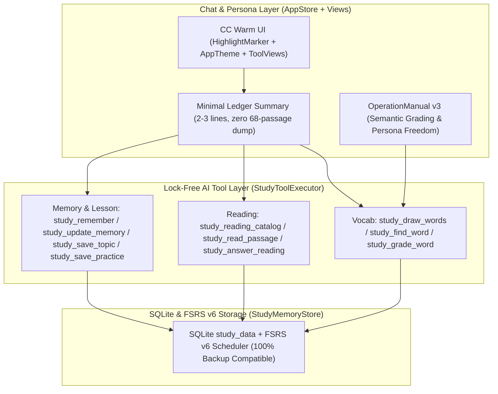

# Study Freedom Architecture & Claude Code (CC) UI Implementation Plan

> **For agentic workers:** REQUIRED SUB-SKILL: Use superpowers:subagent-driven-development (recommended) or superpowers:executing-plans to implement this plan task-by-task. Steps use checkbox (`- [ ]`) syntax for tracking.

**Goal:** Replace Sermo's rigid single-step state-machine study tools and preachy output/prompt locks with a lightweight, lock-free data & FSRS v6 ledger (batch word draw with true shuffle, lookalike word search, semantic lock-free grading, minimal context tokens), while upgrading the chat typography and palette to a warm, cute Claude Code (CC) aesthetic (`1.37.0 build 68`).

**Architecture:** Keep the underlying SQLite `study_data` table and backup row schemas (`word_pack`, `word_progress`, `reading_passage`, `reading_answer`, `memory`, `topic`, `practice`) 100% intact for zero-migration compatibility with existing user data and Google Drive backups, while replacing the LLM-facing tool layer (`StudyWordTools`, `StudyReadingTools`, `StudyLessonTools`, `StudyTools`, `StudyToolExecutor`) with 12 lock-free, optional-argument tools and removing `StudyOutputGuard` from `AppStore` streaming. Simultaneously fix `AttributedString` terracotta bold/code styling in `HighlightMarker.swift` and refine `AppTheme.swift`, `FontLibrary.swift`, `ToolViews.swift`, and `ReasoningView.swift` for authentic CC warmth.

**Architecture Diagram:**



**Tech Stack:** Swift 5.9, SwiftUI (iOS 17+), SQLite3, `swift-fsrs` (FSRS v6), XCTest (`swift test` on macOS + `xcodebuild` for iOS `arm64`).

**Spec:** [2026-11-12-study-freedom-cc-ui-design.md](file:///C:/Users/Administrator/.gemini/antigravity/scratch/qingjian-ios/docs/superpowers/specs/2026-11-12-study-freedom-cc-ui-design.md)

## Global Constraints

- Bundle ID MUST remain `com.xiaolong.qingjian`; marketing version `1.37.0`, build version `68` (`CFBundleVersion = 68`).
- Stay on git branch `cleanup-1.37`; never modify `.github/workflows/*.yml` or `main`.
- Existing SQLite `study_data` rows and `StudyBackupCodec` / `StudyRestoreEngine` archives MUST remain 100% backward-compatible.
- Never reject an AI tool call due to missing optional fields, cross-turn `evidence_quote` mismatches, `expected_revision` mismatches, or `paused` cursor locks.
- Never intercept or rewrite assistant streaming output via `StudyOutputGuard` in `AppStore`.

## Review Focus

- **Cross-turn / batch word grading without an active session:** Calling `study_grade_word` with `word: "adapt", rating: "good"` (or a JSON array `items`) when no `word_session` exists or across turns must still locate `"adapt"` case-insensitively in `word_pack`, schedule FSRS v6 `due`, and update `wordPracticeSummary`.
- **Mid-round shuffle override:** Calling `study_draw_words(mode: "shuffle", count: 10)` while an earlier session is unfinished must immediately draw a freshly shuffled batch of words rather than returning the old ordered queue.
- **Lookalike word search on short or non-Latin queries:** Calling `study_find_word(query: "adapt", match_mode: "lookalike")` must rank `adapt`, `adopt`, `adept`-style edit-distance neighbors first without crashing on 1-char or Chinese queries.
- **Omitted optional parameters in LLM JSON tool calls:** Calling `study_remember`, `study_read_passage`, `study_answer_reading`, or `study_save_practice` with omitted optional keys (e.g. no `weak_point`, no `unit_id`, no `passage_id` when a passage is already open in thread) must succeed with sensible defaults instead of failing `StudyToolAction` key-set validation.
- **SwiftUI outer `.foregroundStyle(Ink.ink)` vs inline `**bold**` & `` `code` ``:** Applying `.foregroundStyle(Ink.ink)` on `MarkdownParagraph` must not erase `Ink.seal` color on `**bold**` or `` `inline code` `` runs inside `AttributedString`.

---

### Task 1: Lock-Free Vocabulary Engine (Batch Draw, True Shuffle, Lookalike Search & Direct FSRS Grading)

**Files:**
- Modify: [StudyVocabulary.swift](file:///C:/Users/Administrator/.gemini/antigravity/scratch/qingjian-ios/QingJian/DeepSeekPocket/Core/StudyVocabulary.swift)
- Modify: [StudyWordTools.swift](file:///C:/Users/Administrator/.gemini/antigravity/scratch/qingjian-ios/QingJian/DeepSeekPocket/Core/StudyWordTools.swift)
- Modify: [StudyWordTests.swift](file:///C:/Users/Administrator/.gemini/antigravity/scratch/qingjian-ios/QingJian/Tests/StudyWordTests.swift)

**Interfaces:**
- Produces in `StudyMemoryStore`:
  - `func drawWords(scope: StudyScope, mode: String, count: Int, unitID: String, now: Date = Date()) throws -> StudyWordDrawResult` (supports `"smart"`, `"shuffle"`, `"review"`, `"unit"`, `"units_overview"`; returns full `[StudyWordView]` batch of 1–30 words transparent to the LLM, using `.shuffled()` for `"shuffle"`, and updates lightweight `word_session` metadata for UI display without cursor locking).
  - `func findWords(projectID: UUID, query: String, matchMode: String = "auto", limit: Int = 15) throws -> [StudyWordView]` (supports `"auto"`, `"lookalike"`, `"prefix_root"`, `"meaning"`; includes Levenshtein edit-distance + shared prefix/stem scoring for lookalike words).
  - `func gradeWordsFree(scope: StudyScope, items: [(word: String, rating: String)], message: ChatMessage, now: Date = Date()) throws -> [StudyWordView]` (resolves each item by exact/case-insensitive `word` or `id` or current session word, supports `"easy"`, `"good"`, `"hard"`, `"again"`, and `"undo"` to revert the latest FSRS log on that word; zero `evidence_quote` / `expected_revision` / timestamp locks).
- Produces in `StudyWordTools`:
  - `static let specs: [ToolSpec]` reduced to 3 clean tools: `study_draw_words`, `study_find_word`, `study_grade_word`.
  - `static let note: String` concise, persona-friendly note emphasizing semantic grading freedom ("阳光" -> "光线" counts as `good`) and zero tool lock-in.

- [ ] **Step 1: Add unit tests in `QingJian/Tests/StudyWordTests.swift` covering batch draw, mid-round shuffle, lookalike search, and cross-turn lock-free single/batch grading + undo**
  Add `testDrawWordsReturnsFullBatchAndShuffleOverridesPreviousQueue()`, `testFindWordsLookalikeRanksAdoptNearAdapt()`, and `testGradeWordsFreeWorksAcrossTurnsWithoutSessionOrQuoteLock()`.
- [ ] **Step 2: Implement `drawWords`, `findWords` (with Levenshtein distance helper), and `gradeWordsFree` in `StudyVocabulary.swift`, keeping existing store methods intact for backup tests**
  Ensure `StudyWordDrawResult` encodes `mode`, `totalInPack`, `dueCount`, `words: [StudyWordView]`, and optional `units: [StudyWordUnitOverview]`.
- [ ] **Step 3: Update `StudyWordTools.swift` to expose the 3 streamlined tools (`study_draw_words`, `study_find_word`, `study_grade_word`) with optional fields and concise `note`**
  Allow `study_grade_word` to accept either `word` + `rating` OR `items` (array of `{word, rating}`).

---

### Task 2: Relaxed Tool Argument Parser, Minimal Context Tokens & Lock-Free Reading/Memory/Lesson Tools

**Files:**
- Modify: [StudyTools.swift](file:///C:/Users/Administrator/.gemini/antigravity/scratch/qingjian-ios/QingJian/DeepSeekPocket/Core/StudyTools.swift)
- Modify: [StudyReadingTools.swift](file:///C:/Users/Administrator/.gemini/antigravity/scratch/qingjian-ios/QingJian/DeepSeekPocket/Core/StudyReadingTools.swift)
- Modify: [StudyReading.swift](file:///C:/Users/Administrator/.gemini/antigravity/scratch/qingjian-ios/QingJian/DeepSeekPocket/Core/StudyReading.swift)
- Modify: [StudyLessonTools.swift](file:///C:/Users/Administrator/.gemini/antigravity/scratch/qingjian-ios/QingJian/DeepSeekPocket/Core/StudyLessonTools.swift)
- Modify: [StudyLessons.swift](file:///C:/Users/Administrator/.gemini/antigravity/scratch/qingjian-ios/QingJian/DeepSeekPocket/Core/StudyLessons.swift)
- Modify: [StudyMemory.swift](file:///C:/Users/Administrator/.gemini/antigravity/scratch/qingjian-ios/QingJian/DeepSeekPocket/Core/StudyMemory.swift)
- Modify: [StudyToolExecutor.swift](file:///C:/Users/Administrator/.gemini/antigravity/scratch/qingjian-ios/QingJian/DeepSeekPocket/Core/StudyToolExecutor.swift)
- Modify: [AppStore.swift](file:///C:/Users/Administrator/.gemini/antigravity/scratch/qingjian-ios/QingJian/DeepSeekPocket/AppStore.swift)
- Modify: [OperationManual.swift](file:///C:/Users/Administrator/.gemini/antigravity/scratch/qingjian-ios/QingJian/DeepSeekPocket/Core/OperationManual.swift)
- Modify: [StudyToolExecutorTests.swift](file:///C:/Users/Administrator/.gemini/antigravity/scratch/qingjian-ios/QingJian/Tests/StudyToolExecutorTests.swift), [StudyReadingTests.swift](file:///C:/Users/Administrator/.gemini/antigravity/scratch/qingjian-ios/QingJian/Tests/StudyReadingTests.swift), [OperationManualTests.swift](file:///C:/Users/Administrator/.gemini/antigravity/scratch/qingjian-ios/QingJian/Tests/OperationManualTests.swift)

**Interfaces:**
- Consumes Task 1 `drawWords`, `findWords`, `gradeWordsFree`.
- Produces:
  - Relaxed `StudyToolAction`: removes `guard Set(arguments.keys) == expected` strict rejection; adds `optionalText(_ key: String, default: String = "")`, `optionalInt(_ key: String)`, `optionalBool(_ key: String, default: Bool = false)`, and `objectArray(_ key: String)`; continues routing both the streamlined 12 LLM tools and legacy internal test tool names so `StudyBackupTests` / `StudyLessonTests` remain 100% green.
  - Streamlined LLM specs:
    - Reading (3 tools): `study_reading_catalog`, `study_read_passage` (fetches paragraph, question, and/or reference answer in 1 lock-free call with `StudyReadingExcerpt` cards), `study_answer_reading` (records `A/B/C/D` or `skip` by `passage_id` + `question` without revision/quote/pause locks).
    - Memory (4 tools): `study_list_memory`, `study_remember`, `study_update_memory` (updates or deletes by `record_id` without requiring `expected_revision` or `evidence_quote`), `study_read_material`.
    - History/Politics & Weekly Report (4 tools): `study_save_topic`, `study_save_practice`, `study_history_search` (combines search & read), `study_weekly_report`.
  - Token-lean `StudyToolExecutor.context(query:)`: removes the 68-line `readingIndex` dump from every English message; emits a compact 2–3 line `[学习账本概况]` summary (`已背 X/4356 词 · 今日 Y · 待复习 Z` + `阅读 N 篇 · 已答 M 题`) plus matching memory notes.
  - Removes `StudyOutputGuard` interception from `AppStore.swift` streaming output so AI persona dialogue is never rewritten.
  - Upgrades `OperationManual.defaultChapters` (`version: 3`) to document the new streamlined tools, semantic word grading ("阳光" vs "光线"), root/lookalike freedom, and relaxed companion-first interaction.

- [ ] **Step 1: Relax `StudyToolAction` and `StudySource.validate` when invoked from lock-free tools, and implement lock-free reading/memory/lesson helpers**
  Ensure omitted optional parameters never throw `StudyMemoryError.invalid("学习操作字段不正确。")`, and cross-turn calls without literal `evidence_quote` succeed cleanly.
- [ ] **Step 2: Wire `StudyToolExecutor` to execute all streamlined tools (while keeping legacy action names routed for existing store/backup tests) and trim `context(query:)` token footprint**
  Verify `context(query: "早安")` in an English project with 68 reading passages stays compact and does not dump all 68 catalog lines unless `query` specifically asks about reading passages or catalog tool is called.
- [ ] **Step 3: Remove `StudyOutputGuard` streaming censorship in `AppStore.swift` and update `OperationManual.swift` built-in chapters to `version: 3`**
  Ensure `AppStore.swift` streams `event.content` directly without rewriting sentences mentioning weekly reports, and update `AppStore.swift` excerpt extraction to recognize `study_read_passage`.
- [ ] **Step 4: Update `StudyToolExecutorTests.swift`, `StudyReadingTests.swift`, and `OperationManualTests.swift` to verify lock-free execution, omitted optional fields, compact context tokens, and v3 manual chapters**

---

### Task 3: Authentic Claude Code (CC) Warm Typography, Color Fix & Cute Activity Pills

**Files:**
- Modify: [HighlightMarker.swift](file:///C:/Users/Administrator/.gemini/antigravity/scratch/qingjian-ios/QingJian/DeepSeekPocket/Views/HighlightMarker.swift)
- Modify: [AppTheme.swift](file:///C:/Users/Administrator/.gemini/antigravity/scratch/qingjian-ios/QingJian/DeepSeekPocket/Views/AppTheme.swift)
- Modify: [FontLibrary.swift](file:///C:/Users/Administrator/.gemini/antigravity/scratch/qingjian-ios/QingJian/DeepSeekPocket/Services/FontLibrary.swift)
- Modify: [ContentView.swift](file:///C:/Users/Administrator/.gemini/antigravity/scratch/qingjian-ios/QingJian/DeepSeekPocket/Views/ContentView.swift)
- Modify: [ToolViews.swift](file:///C:/Users/Administrator/.gemini/antigravity/scratch/qingjian-ios/QingJian/DeepSeekPocket/Views/ToolViews.swift)
- Modify: [ReasoningView.swift](file:///C:/Users/Administrator/.gemini/antigravity/scratch/qingjian-ios/QingJian/DeepSeekPocket/Views/ReasoningView.swift)
- Modify: [Info.plist](file:///C:/Users/Administrator/.gemini/antigravity/scratch/qingjian-ios/QingJian/DeepSeekPocket/Info.plist)

**Interfaces:**
- Produces:
  - `AttributedString.applyingTerracottaCodeAndEmphasis(baseSize: CGFloat, boldColor: Color)` in `HighlightMarker.swift`: sets `foregroundColor = Ink.seal` directly inside `AttributedString` runs for both `.code` and `.stronglyEmphasized` (fixing outer `.foregroundStyle(Ink.ink)` override), and sets `.font = .system(size: max(13, baseSize - 1.5), weight: .medium, design: .monospaced)` + `Ink.seal.opacity(0.14)` background on `.code` spans for crisp CC sugar-pill word tags.
  - Updated `Personal` defaults in `AppTheme.swift`: warm CC parchment cream (`0xFAF9F5` light / `0x191918` dark, sheet `0xF3F0E8` / `0x131312`), warm oat-milk user bubble (`0xEFECE4` / `0x2A2926`), warm deep espresso ink (`0x1F1E1B` / `0xECE9E1`), rich terracotta accent (`0xC96442` / `0xD97757`), and cozy default `paragraphGap` (`18pt`).
  - Default `FontLibrary.choice` when unset: `.system` (clean PingFang SC + SF Pro rounded-modern proportions matching CC, while preserving explicit user choice in Settings).
  - Compact CC-style rounded capsule/pill rows for `ToolActivityList` (`ToolViews.swift`) and `ThinkingRow` (`ReasoningView.swift`).
  - `Info.plist` bumped to `1.37.0` (`CFBundleVersion = 68`).

- [ ] **Step 1: Fix `HighlightMarker.swift` and `MarkdownParagraph` in `ContentView.swift` so `**bold**` and `` `inline code` `` retain `Ink.seal` terracotta color and SF Mono pill typography regardless of outer `.foregroundStyle(Ink.ink)`**
- [ ] **Step 2: Update `AppTheme.swift` (`Personal` presets & spacing) and `FontLibrary.swift` default fallback to `.system`, plus refine `ToolViews.swift` and `ReasoningView.swift` into compact CC warm pills**
- [ ] **Step 3: Bump `CFBundleVersion` to `68` in `QingJian/DeepSeekPocket/Info.plist` (and verify `generate-project.py` / `apply-source-overlay.py` version check if needed)**

---

### Task 4: Project Verification, GitHub Actions CI & Google Drive IPA Delivery

**Files:**
- Modify: `QingJian/QingJian.xcodeproj/project.pbxproj`, `source-overlay.zip`, `source-manifest.json`, `source-deletions.json` (via project scripts)
- Modify: `apply-source-overlay.py` (if build number `68` is pinned in `--check`)

- [ ] **Step 1: Regenerate Xcode project and source overlay locally**
  Run:
  ```powershell
  python "QingJian\scripts\generate-project.py"
  python "QingJian\scripts\check-project.py"
  python rebuild-source-overlay.py
  python apply-source-overlay.py --check
  ```
  Expected: `Verified readable source contents: ... Sermo 1.37.0 build 68.`
- [ ] **Step 2: Commit, push `cleanup-1.37`, and trigger `study-step7.yml` on GitHub Actions**
  Run `gh workflow run study-step7.yml --ref cleanup-1.37` and wait via `schedule` tool until both `Synthetic regression tests` (`swift test --skip StudyLiveModelTests`) and `Build and package unsigned IPA` pass with code 0.
- [ ] **Step 3: Verify built `Info.plist` (`com.xiaolong.qingjian`, `1.37.0`, `build 68`) and copy `Sermo-1.37.0-build68-unsigned.ipa` to `G:\我的云端硬盘\Sermo-1.37.0-build68-unsigned.ipa`**
