# Sermo Full-App 1:1 Claude iOS Visual Overhaul Implementation Plan

> **For agentic workers:** REQUIRED SUB-SKILL: Use superpowers:executing-plans (inline execution with final whole-branch review) to implement this plan task-by-task. Steps use checkbox (`- [ ]`) syntax for tracking.

**Goal:** Unify all 25+ views of Sermo (QingJian iOS) under a cohesive 1:1 Claude iOS visual design system (neutral palette, strict sans-serif UI chrome vs. reading prose typography, white grouped cards, thin uniform icons, native iOS 26 soft edge blur, refined sidebar/chat/settings/projects/study/bookshelf) without changing any persistence schema or breaking Swiss/Night-River themes.

**Architecture:** Build a single foundation layer in `AppTheme.swift` + `FontLibrary.swift` (calibrated neutral palette tokens including `Ink.groupedBg` and `Ink.card`, sans-serif `TypeScale` chrome + explicit `TypeScale.editorialDisplay` for the two serif brand moments, and shared `.claudeGroupedFormStyle()`, `ClaudeSheetCloseButton`, `ClaudeIconBadge`, `ClaudeSecondaryPillStyle` modifiers), then systematically roll it across Sidebar, Chat/Markdown/Composer/Thinking, Settings + all 12 sub-pages, and Projects/Study/AllChats/Bookshelf.

**Architecture Diagram:**

```mermaid
graph TD
    subgraph "Task 1: Foundation"
        T[AppTheme.swift: Ink palette + TypeScale UI chrome + Shared Modifiers]
        F[FontLibrary.swift: v139 migration + ReadingFont]
        P[Core/PeakHours.swift: compactStatusLabel]
        A[AppStore.swift: saveDefaultProvider]
    end
    subgraph "Task 2: Sidebar"
        SP[SidebarPan.swift]
        HV[HistoryView.swift]
    end
    subgraph "Task 3: Chat & Markdown"
        KL[KeyboardChatLayout.swift]
        CV[ContentView.swift]
        WV[WelcomeView.swift]
        RV[ReasoningView.swift + StreamActivityView.swift]
        HM[HighlightMarker.swift + ChatMessagingStyle.swift]
        TV[ToolViews.swift + HTMLPreviewSheet.swift]
    end
    subgraph "Task 4: Settings & 12 Sub-Pages"
        SV[SettingsView.swift + InterfaceStyle.swift]
        SS[Colab + Compatible + Profile + Usage + Feature + Manual + ToolSections]
    end
    subgraph "Task 5: Projects, Study & Bookshelf"
        PV[ProjectsView.swift + AllChatsView]
        SM[StudyMemory + StudyReview + StudyBackup]
        BV[BookshelfView + BookDiscussion + StoryPlay]
    end
    T --> SP & HV & CV & WV & RV & HM & TV & SV & SS & PV & SM & BV
    F --> CV & WV & SV
    P --> HV
    A --> SV
```

**Tech Stack:** Swift 6, SwiftUI (iOS 26 Liquid Glass `.glassEffect`, `.scrollEdgeEffectStyle`), UIKit (`UIScrollView.topEdgeEffect`/`bottomEdgeEffect`, `SidebarDrawerContainer`), XCTest (SwiftPM Core tests + preflight/overlay sync scripts).

**Spec:** `docs/superpowers/specs/2026-11-21-claude-ios-full-ui-overhaul-design.md`

## Global Constraints
- `QingJian/DeepSeekPocket/Core/Models.swift` MUST NOT be modified (`ChatMessage` & `AppSnapshot` zero schema change).
- `.github/workflows/` MUST NOT be modified.
- No private local paths or credentials anywhere in tracked/untracked repository files (`preflight_sermo.py --check-only` gate).
- Preserve `InterfaceStyle.swiss` ("瑞士") and `InterfaceStyle.night` ("夜江") visual identities (Swiss square geometry/borders/mono, Night `MoonDisc`/`MoonPhaseIcon`/gold pill/book spines).
- Preserve all UI test accessibility identifiers and labels (`NavigationUITests.swift`), including `"完成"` accessibility label on `ProjectsView`/`AllChatsView` close buttons.
- Do NOT edit `README.md` without user approval; do NOT stage `README.md` in implementation commits; do NOT `git push` until user confirms.

## Review Focus
1. **iOS 26 API & Swift 6 Concurrency Safety**: Verify every new SwiftUI/UIKit symbol (`scrollEdgeEffectStyle`, `topEdgeEffect`, `bottomEdgeEffect`, `.glassEffect`, `@MainActor`, `Sendable`) matches Xcode 26 / iOS 26 SDK signatures and produces zero actor-isolation warnings/errors.
2. **Dark Mode & Three-Theme Contrast**: Verify `Ink.groupedBg`, `Ink.card`, `Ink.raised`, `Ink.ink`, `ClaudeSecondaryPillStyle`, and code/math cards maintain clean separation and legibility across Light Paper, Dark Paper, Swiss (Light & Dark), and Night-River.
3. **Settings Sub-page Draft Safety**: Verify changing `"默认服务"` on Settings Home calls `store.saveDefaultProvider` without prematurely saving or rejecting unsaved API keys or system prompts in sub-pages, and without breaking `testFontChangeKeepsSettingsAndUnsavedPrompt`.
4. **Sidebar Narrow-Width Footer Layout**: Verify at 390pt width (drawer ~320pt wide) that `38pt` avatar + `余额` + `Pricing.compactStatusLabel()` + `"+ 新建会话"` fit cleanly on one row with zero truncation of `"空闲 · 半价"` and zero vertical overlap with `"查看全部 >"`.
5. **Overlay & Project Manifest Integrity**: Verify `preflight_sermo.py --sync` passes 100% green after all Swift edits with zero manifest drift or private path leaks.

---

### Task 1: Foundation Design System, Palette, Typography Separation & Helpers

**Files:**
- Modify: `QingJian/DeepSeekPocket/Views/AppTheme.swift`
- Modify: `QingJian/DeepSeekPocket/Services/FontLibrary.swift`
- Modify: `QingJian/DeepSeekPocket/Views/InterfaceStyle.swift`
- Modify: `QingJian/DeepSeekPocket/Core/PeakHours.swift`
- Modify: `QingJian/DeepSeekPocket/AppStore.swift`
- Test: `QingJian/Tests/PricingAndImageTests.swift`

**Interfaces:**
- Produces:
  - `Ink.groupedBg: Color`, `Ink.card: Color`, calibrated `Ink.paper`/`Ink.sheet`/`Ink.raised`/`Ink.ink`/`Ink.ink2`/`Ink.ink3`/`Ink.line`
  - `TypeScale.ui(_ size: CGFloat, weight: Font.Weight = .regular, relativeTo style: Font.TextStyle = .body) -> Font`
  - `TypeScale.editorialDisplay(_ size: CGFloat, weight: Font.Weight = .regular, relativeTo style: Font.TextStyle = .title) -> Font`
  - `ClaudeSheetCloseButton(label: String = "关闭", action: @escaping () -> Void)`
  - `ClaudeIconBadge(systemName: String, color: Color = Ink.ink2)`
  - `ClaudeSecondaryPillStyle` / `extension View { func claudeGroupedFormStyle() -> some View; func claudeGroupedListStyle() -> some View }`
  - `Pricing.compactStatusLabel(at date: Date = Date()) -> String`
  - `AppStore.saveDefaultProvider(_ provider: AIProvider)`

- [ ] **Step 1:** Add unit test for `Pricing.compactStatusLabel(at:)` in `QingJian/Tests/PricingAndImageTests.swift` verifying peak (`"高峰时段"`) vs off-peak (`"空闲 · 半价"`) concise output (<= 8 chars).
- [ ] **Step 2:** Implement `Pricing.compactStatusLabel(at:)` in `QingJian/DeepSeekPocket/Core/PeakHours.swift`.
- [ ] **Step 3:** Implement `AppStore.saveDefaultProvider(_ provider: AIProvider)` in `QingJian/DeepSeekPocket/AppStore.swift` (updates `settings.provider` and empty non-project threads, persists snapshot, never touches Keychain/API key).
- [ ] **Step 4:** Update `FontLibrary.swift` (`applyReadingDefaultsOnce()` v139 one-time migration to `.system` 17pt for non-custom users) and `AppTheme.swift` (calibrated neutral palette, `Ink.groupedBg`, `Ink.card`, sans-serif `TypeScale`, `TypeScale.editorialDisplay`, `InkAppearance` sans nav titles, `SidebarGlyph` 3 balanced thin lines, `Personal.mediumBody`/`boldUsesAccent` defaulting to `false`, `ClaudeSheetCloseButton`, `ClaudeIconBadge`, `ClaudeSecondaryPillStyle`, `.claudeGroupedFormStyle()`, `.claudeGroupedListStyle()`).
- [ ] **Step 5:** Update `InterfaceStyle.swift` `PersonalizationView` (remove `.font(TypeScale.body)`, apply `.claudeGroupedFormStyle()`, update default reset to `17`, refine `PersonalPreview` to match neutral palette & regular/bold contrast).
- [ ] **Step 6:** Run static Swift brace/syntax check across modified files and commit Task 1.

---

### Task 2: Sidebar Drawer & Conversation Versions 1:1 Overhaul

**Files:**
- Modify: `QingJian/DeepSeekPocket/Views/SidebarPan.swift`
- Modify: `QingJian/DeepSeekPocket/Views/HistoryView.swift`

**Interfaces:**
- Consumes: `Ink.sheet`, `Ink.groupedBg`, `Ink.card`, `Ink.raised`, `TypeScale.editorialDisplay`, `TypeScale.ui`, `ClaudeSheetCloseButton`, `ClaudeSecondaryPillStyle`, `Pricing.compactStatusLabel()`

- [ ] **Step 1:** Update `SidebarPan.swift`: remove `backContainerView.layer.cornerRadius` and `backContainerView.layer.borderWidth`, soften front card shadow (`shadowOpacity = 0.08`, `shadowRadius = 18`).
- [ ] **Step 2:** Update `HistorySidebar` in `HistoryView.swift`:
  - `Sermo` wordmark in `TypeScale.editorialDisplay(25, weight: .medium)` (Swiss keeps `PingFangSC-Semibold`), `40×40` subtle search circle.
  - Thin uniform icons (`17pt` `.light` `Ink.ink2`) for `项目`, `书架`, pinned projects; rounded `message` / `message.fill` chat icons in Paper (preserving `MoonPhaseIcon` in Night); crisp sans-serif `15.5pt` titles; subtle `Ink.raised` active capsule.
  - `contentMargins(.bottom, 110)` + smooth `Ink.sheet` fade mask behind footer so `"查看全部 >"` never collides with avatar.
  - Footer: `38×38` avatar + crisp 2-line balance & `Pricing.compactStatusLabel()` (zero truncation) + `"+ 新建会话"` styled via `ClaudeSecondaryPillStyle` (preserving Night gold pill and Swiss square black pill).
- [ ] **Step 3:** Update `ConversationVersionsSheet` in `HistoryView.swift` to use `.claudeGroupedListStyle()`, `Ink.card` rows, and `ClaudeSheetCloseButton(label: "完成")`.
- [ ] **Step 4:** Run static Swift brace/syntax check and commit Task 2.

---

### Task 3: Chat Main Screen, Welcome, Thinking, Markdown, Composer & Modals 1:1 Overhaul

**Files:**
- Modify: `QingJian/DeepSeekPocket/Views/KeyboardChatLayout.swift`
- Modify: `QingJian/DeepSeekPocket/Views/WelcomeView.swift`
- Modify: `QingJian/DeepSeekPocket/Views/ReasoningView.swift`
- Modify: `QingJian/DeepSeekPocket/Views/StreamActivityView.swift`
- Modify: `QingJian/DeepSeekPocket/Views/ChatMessagingStyle.swift`
- Modify: `QingJian/DeepSeekPocket/Views/HighlightMarker.swift`
- Modify: `QingJian/DeepSeekPocket/Views/ContentView.swift`
- Modify: `QingJian/DeepSeekPocket/Views/ToolViews.swift`
- Modify: `QingJian/DeepSeekPocket/Views/HTMLPreviewSheet.swift`

**Interfaces:**
- Consumes: `Ink.*`, `TypeScale.editorialDisplay`, `TypeScale.ui`, `ClaudeSheetCloseButton`, `.claudeGroupedFormStyle()`, `.claudeGroupedListStyle()`
- Produces: `ClaudeThinkingDots` in `ReasoningView.swift`

- [ ] **Step 1:** Update `KeyboardChatLayout.swift`: configure `scroll.topEdgeEffect.isHidden = false; scroll.topEdgeEffect.style = .soft` and `scroll.bottomEdgeEffect.isHidden = false; scroll.bottomEdgeEffect.style = .soft` (retaining horizontal-bounce lock).
- [ ] **Step 2:** Update `WelcomeView.swift`: Paper uses `ThinkingMark(live: false, size: 28)` + `TypeScale.editorialDisplay(27)` greeting; Night keeps `MoonDisc`; Swiss keeps `swissBody`.
- [ ] **Step 3:** Update `ReasoningView.swift` and `StreamActivityView.swift`: add `ClaudeThinkingDots`, surface live thinking `snippet` while streaming, display thin `clock` icon + `"已思考 X 秒"` when finished, align `ThinkingSheet` with `Ink.groupedBg`/`ClaudeSheetCloseButton`; preserve `PulseDot` for Night/Swiss in `StreamActivityView`.
- [ ] **Step 4:** Update `ChatMessagingStyle.swift` (`MessageTimeDivider.shouldShow` returns `false` for `previous == nil`) and `HighlightMarker.swift` (neutral inline code chips `#ECEBE6`/`#2A2A27` + near-black text, pure black bold default).
- [ ] **Step 5:** Update `ContentView.swift`:
  - Top/bottom `.scrollEdgeEffectStyle(.soft, for: .top)` and `.bottom`; subtle status-bar safety fade (`topInset + 16`); sheer translucent bottom composer fade so text drifts behind `.clearGlass(radius: 26)` composer; centered floating `↓` button in `ChatFloatingControlsOverlay`.
  - Refined top-right toolbar icons (`.regular` weight).
  - Markdown rhythm: `12pt` list spacing, semibold numbered hanging-indent markers (`6pt` gap), neutral `MarkdownCodeBlockView` (`Ink.card` + `0.8pt Ink.line` + `Ink.ink3` header/copy), neutral `MarkdownMathBlockView`, neutral blockquote bar.
  - Refined assistant action bar (`14.5pt` `.light`, `character.cursor.ibeam` instead of crop-like icon, compact retry-only bar on empty failed messages).
  - Refined slim composer (`34pt` `+`, model pill, slim muted `globe`, neutral idle send circle / terracotta ready / calm stop button).
  - Unify `EditMessageView`, `DocumentPreviewSheet`, and in-chat search/bookmarks sheets with `ClaudeSheetCloseButton` and `Ink.groupedBg`/`Ink.card`.
- [ ] **Step 6:** Update `ToolViews.swift` and `HTMLPreviewSheet.swift` (`#F8F8F6` backdrop, `ClaudeSheetCloseButton`, neutral card strokes).
- [ ] **Step 7:** Run static Swift brace/syntax check and commit Task 3.

---

### Task 4: Settings Home & All 12 Settings Sub-Pages Unification

**Files:**
- Modify: `QingJian/DeepSeekPocket/Views/SettingsView.swift`
- Modify: `QingJian/DeepSeekPocket/Views/ColabSettingsView.swift`
- Modify: `QingJian/DeepSeekPocket/Views/CompatibleEndpointSettingsView.swift`
- Modify: `QingJian/DeepSeekPocket/Views/ProfileView.swift`
- Modify: `QingJian/DeepSeekPocket/Views/UsageView.swift`
- Modify: `QingJian/DeepSeekPocket/Views/FeatureOverviewView.swift`
- Modify: `QingJian/DeepSeekPocket/Views/OperationManualView.swift`
- Modify: `QingJian/DeepSeekPocket/Views/ToolSettingsSections.swift`
- Modify: `QingJian/DeepSeekPocket/Views/SubscriptionSettingsSection.swift`
- Modify: `QingJian/DeepSeekPocket/Views/ChatConnectionTestView.swift`

**Interfaces:**
- Consumes: `Ink.groupedBg`, `Ink.card`, `ClaudeSheetCloseButton`, `ClaudeIconBadge`, `.claudeGroupedFormStyle()`, `.claudeGroupedListStyle()`, `store.saveDefaultProvider(_:)`

- [ ] **Step 1:** Overhaul `SettingsView.swift`:
  - Inline centered `"设置"` title, top-left `ClaudeSheetCloseButton(label: "关闭")`, top-right `info` circular button presenting `aboutPage` (sheet or navigation); remove top-level `"取消"`/`"保存"`.
  - `"默认服务"` picker calls `store.saveDefaultProvider(newValue)` and mirrors `draftSettings.provider = newValue`.
  - Profile row placed inside first `Ink.card` white rounded card; all rows use `ClaudeIconBadge` (including `slider.horizontal.3` for `"默认服务"`).
  - Remove `.font(TypeScale.body)` from main `Form`, `page(...)`, `SystemPromptLibraryView`, `SystemPromptEditor`, `SystemPromptPickerSheet`, `LocalDataStatusView`, `UnifiedRestorePreviewSheet`; apply `.claudeGroupedFormStyle()` / `.claudeGroupedListStyle()` and `Ink.card` row backgrounds.
- [ ] **Step 2:** Apply `.claudeGroupedFormStyle()` to `CompatibleEndpointSettingsView.swift` (fixes stock iOS grey/blue rupture) and `ColabSettingsView.swift` (removes `.font(TypeScale.body)`).
- [ ] **Step 3:** Unify `ProfileView.swift`, `UsageView.swift`, `FeatureOverviewView.swift`, `OperationManualView.swift`, `ToolSettingsSections.swift`, `SubscriptionSettingsSection.swift`, and `ChatConnectionTestView.swift` onto `.claudeGroupedFormStyle()` / `.claudeGroupedListStyle()` white cards, clean sans typography, and `ClaudeSheetCloseButton`.
- [ ] **Step 4:** Run static Swift brace/syntax check and commit Task 4.

---

### Task 5: Projects, Study Views, All Chats, Bookshelf & Story/Discussion Modals Unification

**Files:**
- Modify: `QingJian/DeepSeekPocket/Views/ProjectsView.swift`
- Modify: `QingJian/DeepSeekPocket/Views/StudyMemoryView.swift`
- Modify: `QingJian/DeepSeekPocket/Views/StudyReviewView.swift`
- Modify: `QingJian/DeepSeekPocket/Views/StudyBackupView.swift`
- Modify: `QingJian/DeepSeekPocket/Views/BookshelfView.swift`
- Modify: `QingJian/DeepSeekPocket/Views/BookDiscussionViews.swift`
- Modify: `QingJian/DeepSeekPocket/Views/StoryPlayViews.swift`

**Interfaces:**
- Consumes: `Ink.groupedBg`, `Ink.card`, `Ink.raised`, `ClaudeSheetCloseButton`, `ClaudeIconBadge`, `ClaudeSecondaryPillStyle`, `.claudeGroupedFormStyle()`, `.claudeGroupedListStyle()`, `TypeScale.editorialDisplay`

- [ ] **Step 1:** Overhaul `ProjectsView.swift`:
  - `ProjectsView` & `AllChatsView`: `.claudeGroupedListStyle()` (`Ink.card` white cards on `Ink.groupedBg`), inline centered titles, `ClaudeSheetCloseButton(label: "完成")` (keeps `NavigationUITests` passing), thin uniform icons.
  - `ProjectPageView`: unified grouped card layout on `Ink.groupedBg` (white rounded action buttons for 文件/指令 with thin icons, white grouped card for Memory/Study with calm neutral word chips, white grouped conversation cards with circular `message` icons, `ClaudeSecondaryPillStyle` `"+ 新建会话"` pill).
  - Sub-sheets (`ProjectFilesView`, `ProjectInstructionsSheet`, `ProjectMemoryView`, `ProjectServiceSheet`, `ProjectDesignerView`, restore study sheet): `.claudeGroupedFormStyle()` / `.claudeGroupedListStyle()` and `ClaudeSheetCloseButton`.
- [ ] **Step 2:** Unify `StudyMemoryView.swift`, `StudyReviewView.swift`, and `StudyBackupView.swift`: remove `.font(TypeScale.body)` from all Forms, apply `.claudeGroupedFormStyle()` (fixing `StudyReviewView`), calm terracotta tag overuse to neutral `Ink.raised` chips, unify `ClaudeSheetCloseButton`.
- [ ] **Step 3:** Unify `BookshelfView.swift`, `BookDiscussionViews.swift`, and `StoryPlayViews.swift`: preserve `ShelfAtmosphere` blurred covers & Night-River book spines (`TypeScale.editorialDisplay` for book titles), remove `.font(TypeScale.body)` from all modal forms, apply `.claudeGroupedFormStyle()` / `.claudeGroupedListStyle()` and `ClaudeSheetCloseButton`.
- [ ] **Step 4:** Run static Swift brace/syntax check and commit Task 5.

---

### Task 6: Preflight Sync, Whole-Branch Final Review & Verification

**Files:**
- Sync: `QingJian/DeepSeekPocket.xcodeproj/project.pbxproj`, `source-manifest.json`, `source-overlay/` (via `preflight_sermo.py --sync`)

- [ ] **Step 1:** Confirm `git diff --name-only` has ZERO changes to `QingJian/DeepSeekPocket/Core/Models.swift` and `.github/workflows/`.
- [ ] **Step 2:** Run comprehensive Python static Swift validator across all modified `.swift` files (balanced `{}`/`()`/`[]`, string/comment-aware, no duplicate struct/func declarations, no leaked local paths).
- [ ] **Step 3:** Run `preflight_sermo.py --sync` and verify all 4 sync steps + read-only checks pass green.
- [ ] **Step 4:** Commit synced overlay/manifest cleanly (excluding uncommitted `README.md`).
- [ ] **Step 5:** Dispatch `final-reviewer` subagent over full `MERGE_BASE..HEAD` diff against spec + Review Focus; address any Critical/Important findings in one clean pass, re-sync `preflight_sermo.py --sync`, and commit.
